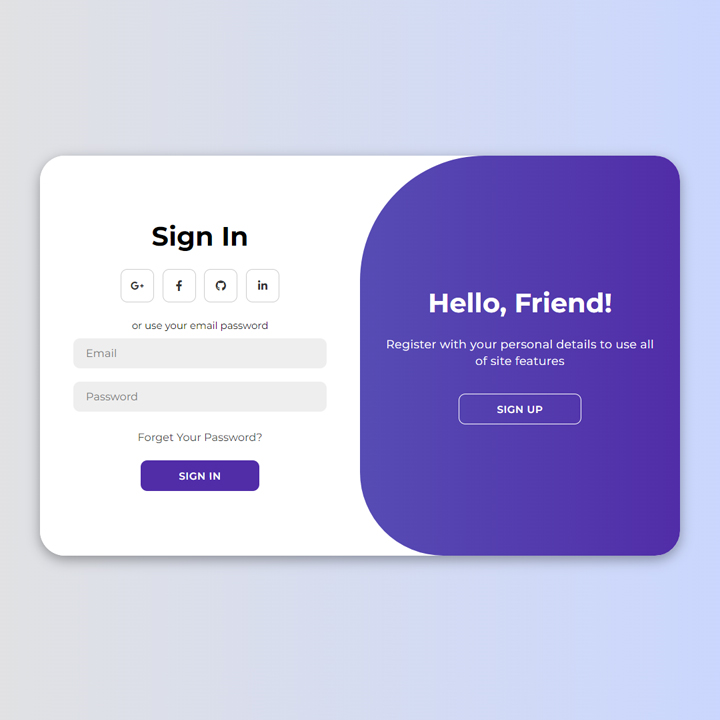

# Modern Login Page

Sign-in and sign-up forms on one card, with a sliding overlay to switch between them.

## Features

- Animated switch between the two forms
- Social login buttons (design only)

## Run it

No build step. Open `index.html` in a browser, or serve the folder with any static server, for example `python -m http.server`.

## Screenshots

